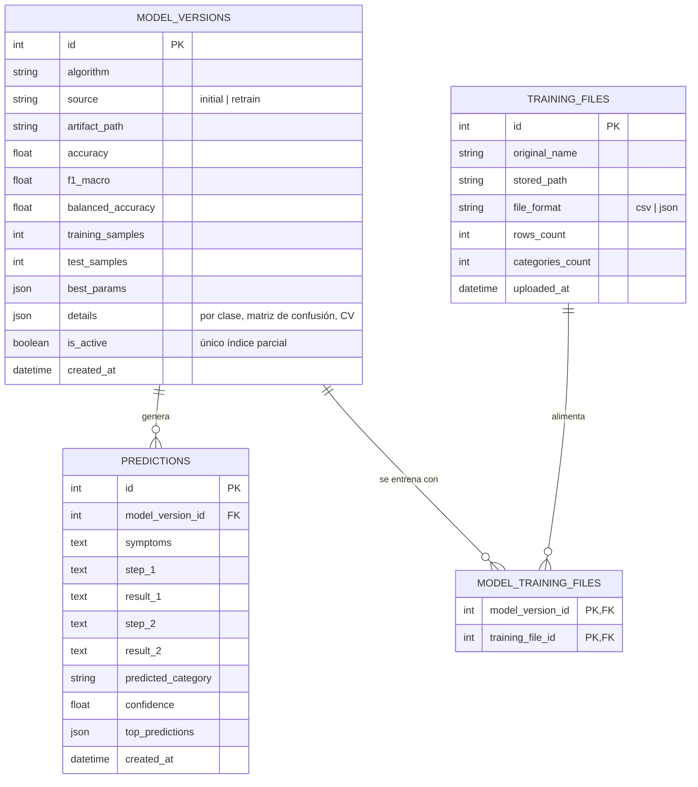

# Diagrama entidad-relación

Script de creación: [`schema.sql`](schema.sql) (SQLite; comentarios indican los tipos equivalentes en PostgreSQL).
La aplicación crea las mismas tablas al arrancar mediante SQLAlchemy (`app/models.py`).
